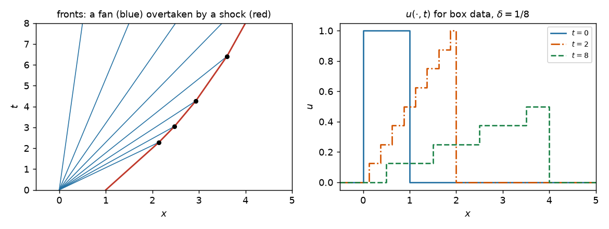

# fronttrack

[](https://github.com/surya-aero23/front-tracking-burgers/actions/workflows/tests.yml)
[](https://surya-aero23.github.io/front-tracking-burgers/)
[](LICENSE)

**Exact front tracking for one-dimensional scalar conservation laws**

    u_t + f(u)_x = 0,    u(x, 0) = u_0(x)

`fronttrack` computes weak entropy solutions by the front-tracking method of
Holden and Risebro. The flux is replaced by its piecewise linear interpolant
`f_delta`, so that every Riemann problem resolves into finitely many
discontinuities. The solution stays piecewise constant, every front moves in
a straight line, and each collision is a new Riemann problem — solved in
exact rational arithmetic, with no time step and no tolerance.



**Documentation:** <https://surya-aero23.github.io/front-tracking-burgers/>

## Features

- **Exact.** `fractions.Fraction` throughout: a triple collision is one
  event, and mass, total variation and the entropy inequalities are checked
  exactly.
- **Any flux.** Riemann problems by the convex/concave envelope
  construction: Burgers, concave and nonconvex fluxes such as
  Buckley–Leverett.
- **Real line or periodic**, with one event loop for both.
- **Any data.** Piecewise constant data directly; smooth data by cell
  averaging and rounding to the `delta` grid.
- **Verified.** Rankine–Hugoniot, Oleinik and Kružkov on every front; the
  weak form to round-off; property-based tests of L¹ contraction,
  comparison, the maximum principle, finite speed and error bounds; exact
  references (Burgers, Buckley–Leverett, shock formation from a sine wave);
  and an independent Godunov finite-volume comparison.

## Installation

```bash
git clone https://github.com/surya-aero23/front-tracking-burgers.git
cd front-tracking-burgers
pip install -e ".[dev]"
```

Python 3.10 or newer, with NumPy and Matplotlib.

## Quick start

```pycon
>>> from fronttrack import Burgers, FrontTracker, PiecewiseConstant, riemann_data
>>> solver = FrontTracker(Burgers(), delta="1/8")
>>> solver.solve(riemann_data(1, 0), t_final=2).state_at(2)
PiecewiseConstant(breakpoints=(Fraction(1, 1),), values=(Fraction(1, 1), Fraction(0, 1)))

>>> box = PiecewiseConstant(breakpoints=(0, 1), values=(0, 1, 0))
>>> solution = solver.solve(box, t_final=12)
>>> solution.n_fronts, solution.n_interactions, solution.total_variation(12)
(14, 5, Fraction(3, 4))

```

Check the solution against the theory:

```pycon
>>> from fronttrack import check_all_fronts, mass_defect
>>> all(report.ok for report in check_all_fronts(solution))
True
>>> mass_defect(solution, t=12, a=-20, b=20)
Fraction(0, 1)

```

Periodic, smooth data — a shock forming from a sine wave:

```pycon
>>> import numpy as np
>>> from fronttrack import Periodic, project
>>> data = project(lambda x: np.sin(2 * np.pi * x), window=(0, 1), cells=64, delta="1/16")
>>> ring = FrontTracker(Burgers(), delta="1/16", domain=Periodic(0, 1))
>>> ring.solve(data, t_final=1).state_at(1).mass(0, 1)
Fraction(0, 1)

```

See the [user guide](https://surya-aero23.github.io/front-tracking-burgers/guide.html)
and the [examples](https://surya-aero23.github.io/front-tracking-burgers/examples.html).

## Repository layout

| Path | Contents |
| --- | --- |
| `src/fronttrack/` | the package: fluxes, envelopes, Riemann solver, event loop, domains, diagnostics, exact solutions, comparison schemes, plotting |
| `tests/` | unit, property-based and convergence tests |
| `docs/` | the Sphinx documentation |
| `scripts/make_readme_figure.py` | regenerates the figure at the top of this README |

## Development

```bash
pip install -e ".[dev,docs]"
pytest                                   # tests, property tests and doctests
sphinx-build -W docs docs/_build/html    # documentation
python scripts/make_readme_figure.py     # the README figure
```

See [CONTRIBUTING.md](CONTRIBUTING.md).

## Background

This started as the course project for MA 347B, *Hyperbolic Conservation
Laws: Theory, Numerics and Applications*, at the Indian Institute of
Science. The method follows H. Holden and N. H. Risebro, *Front Tracking for
Hyperbolic Conservation Laws* (Springer, 2nd ed., 2015).

## Citation

If you use this code, please cite it using the metadata in
[CITATION.cff](CITATION.cff).

## License

[MIT](LICENSE)
